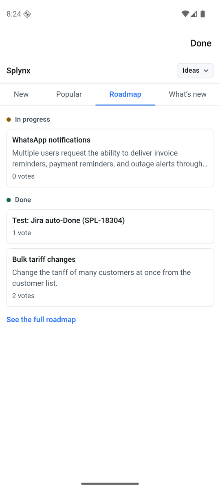
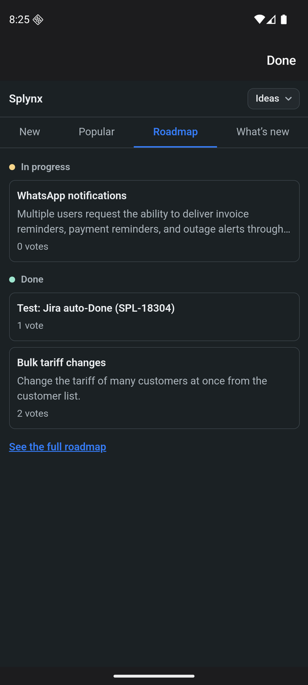

# AntNexo for Android

Put your [AntNexo](https://antnexo.com) feedback board, roadmap and What's new inside your Android app. People post
ideas and bugs, vote, follow the roadmap and read your release notes without leaving the app. Every post carries the
app's version, Android version and device model, so you know where it came from.

<p>
  
  
</p>

- Android 7.0+ (API 24), Kotlin 2, Jetpack Compose and Views
- The person can post as a guest (where your workspace allows it), sign in with an email code, Google or GitHub, or be
  signed in by your app (identify)
- 25 languages; light and dark follow the system
- MIT licence

## Install

From [JitPack](https://jitpack.io/#AntNexo/antnexo-android) (Maven Central follows). In `settings.gradle.kts`:

```kotlin
dependencyResolutionManagement {
    repositories {
        google()
        mavenCentral()
        maven("https://jitpack.io")
    }
}
```

and in your app's `build.gradle.kts`:

```kotlin
dependencies {
    implementation("com.github.AntNexo.antnexo-android:antnexo-android-compose:v1.2.0") // Compose (includes the core)
    // or, for Views only:
    implementation("com.github.AntNexo.antnexo-android:antnexo-android:v1.2.0")
}
```

## Show the sheet

Configure once, in `Application.onCreate`, with your workspace's board host. Use `https://<slug>.antnexo.com`: it works
on every plan and keeps working if you add or change a custom domain.

```kotlin
class App : Application() {
    override fun onCreate() {
        super.onCreate()
        AntNexo.configure(this, "https://acme.antnexo.com", "acme")
    }
}
```

**Compose**

```kotlin
var feedback by rememberSaveable { mutableStateOf(false) }

Button(onClick = { feedback = true }) { Text("Send feedback") }
AntNexoSheet(visible = feedback, onDismiss = { feedback = false })
```

**Views**

```kotlin
AntNexo.show(activity)
AntNexo.show(activity, tab = FeedbackTab.ROADMAP)
```

Tabs: `NEW`, `POPULAR`, `ROADMAP`, `CHANGELOG`. More options at `configure`:

```kotlin
AntNexo.configure(this, "https://acme.antnexo.com", "acme", FeedbackOptions(
    tabs = listOf(FeedbackTab.NEW, FeedbackTab.ROADMAP, FeedbackTab.CHANGELOG), // which tabs, in that order
    boards = listOf("ideas", "bugs"),     // which boards
    theme = FeedbackTheme.AUTO,           // LIGHT, DARK or AUTO (the default)
    color = "#4f46e5",                    // accent
    prompts = true,                       // your team's in-app questions
    whatsNew = WhatsNewMode.BADGE,        // BADGE, POPUP or OFF
    language = null,                      // by default the app's language
))
```

## Sign the person in from your app (identify)

If your app has its own accounts, sign the person in to the board as themselves: your **backend** signs a short-lived
HS256 JWT with the workspace's identify secret (admin → Settings → Board, the Widget card → Identify secret) — `sub`,
`email`, `exp` (≤ 24 h), optionally `name`, `company`, `mrr` — and the app fetches it when the sheet opens:

```kotlin
AntNexo.identify { myApi.antnexoToken() }   // a suspend call to your endpoint; return null to open signed out
```

The provider is called each time the sheet opens; if it fails, returns null or takes longer than 10 seconds, the sheet
opens anyway and the person can sign in our way. **Never put the identify secret in the app.** The token goes to the
page through the bridge, never in a URL or a log.

On every account switch (sign out, another user), make the provider stop returning the old person's token and clear
the sheet's session:

```kotlin
AntNexo.identify(null)      // or a provider for the new account
AntNexo.logout()            // suspend; closes an open sheet
```

## What's new badge

```kotlin
val count = AntNexo.unreadCount()   // suspend: entries the person hasn't seen yet
```

It throws when the board can't be reached (`IOException`) or answers wrongly (`AntNexoException`). The count is kept
in step with the sheet: when the person opens What's new there, `onEvent` reports `Unread(0)`.

## Screenshot

```kotlin
AntNexo.show(activity, screenshot = true)
AntNexoSheet(visible = feedback, onDismiss = { feedback = false }, screenshot = true)
```

Takes a screenshot of the app as it is (before the sheet opens) and offers it as an attachment on the new post. The
person sees it and can remove it; it is uploaded only when they send, only when they are signed in and your workspace
has attachments on. Off by default: the screen can hold private data. A window marked `FLAG_SECURE` is never captured.

## Events

```kotlin
AntNexo.onEvent = { event ->
    when (event) {
        is AntNexoEvent.Posted -> Log.i("app", "new post ${event.id}")
        is AntNexoEvent.Unread -> badge = event.count
        is AntNexoEvent.SignedIn -> Log.i("app", "signed in: ${event.signedIn}")
        is AntNexoEvent.IdentifyFailed -> Log.w("app", "identify refused: ${event.code}") // e.g. an expired token
        AntNexoEvent.Closed -> Unit
    }
}
```

Events arrive on the main thread. `AntNexo.addEventListener` adds more listeners.

## Privacy

Nothing personal is sent before the sheet opens: the only earlier request is the public changelog, when you call
`unreadCount()` for a badge. With a post the SDK sends the app's name, version and build, the Android version, the
device model (`Build.MODEL`), the locale and the SDK version — no device identifiers, no advertising ID, no tracking.
Your workspace shows them on the post in the admin; erasing a person removes them. The library asks for no permission
but `INTERNET`.

## How it works (design notes)

- The sheet is AntNexo's widget in app mode (`<host>/app`) in a `WebView` inside an activity of the library, with a
  small native bridge: features and fixes reach your app without an app update. You can also use your own WebView with
  the same bridge contract.
- The bridge needs Android System WebView with `DOCUMENT_START_SCRIPT` and `WEB_MESSAGE_LISTENER` (every WebView
  since 2021). On an older one the sheet says to update it; there is no weaker fallback.
- The bridge (`window.AntNexoApp`) is injected with `addDocumentStartJavaScript` only on your board's origin, and
  messages are taken through `addWebMessageListener` only from the main frame on that origin (exact scheme, host and
  port). No `addJavascriptInterface`. Each message is validated; links and sign-in open only while the sheet is in
  front.
- The WebView loads only that page once; every other navigation is refused, links open in a Custom Tab, and new
  windows are never created.
- Google and GitHub sign-in run in a Custom Tab (Google refuses sign-in inside WebViews), and only for your board's own
  OAuth start URL. When the person is signed in, the tab closes by itself.
- The sheet keeps the board session in the board origin's web storage. `logout()` closes the sheet and clears that
  storage when the sheet next opens (Android's `WebStorage.deleteOrigin` doesn't clear `localStorage`).
- Rotating the device or switching dark mode keeps the page and what the person typed.
- The file picker offers the image types the widget accepts; only content the person picked from another app is
  uploaded.
- Plain `http` hosts are accepted only for local development (`*.localhost`, 127/8, `::1`, the emulator's `10.0.2.2`,
  Genymotion's `10.0.3.2`). Android also blocks cleartext by default, so a debug build that opens a local board needs a
  network security config allowing it (see `sample/src/debug`).
- If the page can't load (offline), the sheet says so and offers Try again.
- A renamed workspace slug changes the host: ship the new one in an update.
- R8/ProGuard: no rules needed.
- Wrappers of this library (the React Native SDK) set the platform and SDK version the page reports through
  `AntNexo.setWrapper` (opt-in `@AntNexoWrapperApi`); apps don't call it.

## Sample app

`sample/` (Compose): `./gradlew :sample:installDebug`. It opens `https://splynx.antnexo.com` by default; another board:
`adb shell am start -n com.antnexo.sample/.MainActivity --es host https://<slug>.antnexo.com --es workspace <slug>`.

## Licence

MIT — see [LICENSE](LICENSE).
